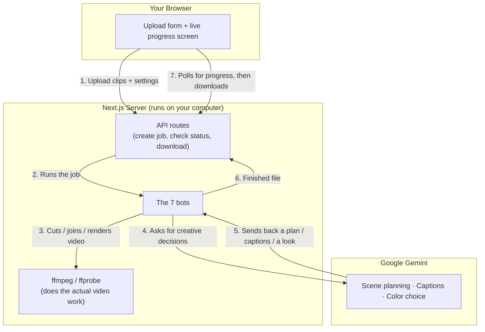

# Cutting Room


---------------------------------

**Upload your raw video clips → get back a finished, edited video.**

Cutting Room is a little pipeline of specialist "bots" that each handle one
part of video editing — cutting, transitions, captions, music, color, and
final export — so you don't have to do it by hand.

```
   Raw clips  +  optional script  +  optional music
                        │
                        ▼
              ┌──────────────────────┐
              │     CUTTING ROOM     │
              └──────────────────────┘
                        │
                        ▼
         One finished, platform-ready video
```

> This is a Next.js (JavaScript/TypeScript) rewrite of an earlier Python
> version. It no longer needs Python, moviepy, or Whisper — everything
> runs through **ffmpeg** (video processing) and **Google Gemini**
> (the "smart" decisions, like where to cut and what caption to show).

---

## What it actually does

Think of it like a real editing room with seven specialists, each waiting
for the previous one to hand off their work:

```mermaid
flowchart LR
    A["Script Bot\n(plans the scenes)"] --> B["Cutter Bot\n(trims clips)"]
    B --> C["Transition Bot\n(joins the cuts)"]
    C --> D["Caption Bot\n(adds subtitles)"]
    D --> E["Audio Bot\n(mixes music)"]
    E --> F["Color Bot\n(applies a look)"]
    F --> G["Export Bot\n(final render)"]

    style A fill:#2b2438,stroke:#a78bfa,color:#fff
    style B fill:#1f2937,stroke:#60a5fa,color:#fff
    style C fill:#1f2937,stroke:#60a5fa,color:#fff
    style D fill:#1f2937,stroke:#60a5fa,color:#fff
    style E fill:#1f2937,stroke:#60a5fa,color:#fff
    style F fill:#2b2438,stroke:#a78bfa,color:#fff
    style G fill:#14532d,stroke:#4ade80,color:#fff
```



| Bot | What it's doing, in plain English |
|---|---|
| **Script Bot** | *Only runs if you paste in a script.* Reads your script and decides pacing — which clip goes where, how long each shot should be, and where to put the "hook" that grabs attention. |
| **Cutter Bot** | Trims each clip down to exactly the part it needs, and resizes everything to fit your target platform (e.g. tall for TikTok, wide for YouTube). |
| **Transition Bot** | Glues the trimmed clips together — sometimes a hard cut, sometimes a fade or dissolve, depending on the mood of that moment. |
| **Caption Bot** | Listens to the audio, writes out subtitles, and burns them onto the video. |
| **Audio Bot** | If you gave it background music, blends it in under the voice (and quiets the music while someone's talking). If not, it just cleans up the volume levels. |
| **Color Bot** | Picks a color "look" (vibrant, cinematic, moody, clean, etc.) that fits the platform and mood, and applies it. |
| **Export Bot** | Renders the final file at the right size and quality for YouTube, TikTok, or Reels. |

**Nothing here ever breaks the whole job.** If you don't add a script, Script
Bot just steps aside. If you don't have a Gemini API key set up, the bots
that need AI (Script, Caption, Color) quietly use safe defaults instead of
crashing — you still get a finished video either way.

---

## How the pieces fit together



Everything runs on your own machine: your video files never leave your
computer except for short audio clips sent to Gemini for transcription
and small text prompts sent for planning/color decisions.

---

## What you need before you start

| Requirement | Why | Get it |
|---|---|---|
| **Node.js 20+** | Runs the app | [nodejs.org](https://nodejs.org) |
| **ffmpeg & ffprobe** | Does the actual video cutting/rendering | `brew install ffmpeg` (Mac) or your package manager |
| **A Google Gemini API key** *(optional)* | Powers the "smart" steps (scene planning, captions, color) | [aistudio.google.com/apikey](https://aistudio.google.com/apikey) — free tier available |

> Skipping the API key is fine — you'll still get a fully cut, color-graded,
> exported video. You'll just miss the AI-planned pacing, auto-captions,
> and AI-picked color look.

---

## Setup — step by step

**1. Install the dependencies**
```bash
npm install
```

**2. Create your settings file**
```bash
cp .env.local.example .env.local
```

**3. Add your API key** (skip this if you don't have one yet)

Open `.env.local` in any text editor and replace the placeholder:
```
GOOGLE_API_KEY="your-key-here"
```

**4. Start the app**
```bash
npm run dev
```

**5. Open it in your browser**

Go to **http://localhost:3000** — you'll see the upload screen.

---

## Using it

1. **Upload clips** — pick one or more video files, in any order.
2. **(Optional) Add music** — one audio file to play under the video.
3. **(Optional) Paste a script** — if you have a voiceover/talking-track
   script, paste it in and Script Bot will use it to plan pacing.
4. **Pick a platform** — YouTube (widescreen), TikTok, or Reels (both tall).
5. **Pick a style** — Dynamic (fast cuts), Calm (soft dissolves), or
   Cinematic (slower fades).
6. **Hit "Start the cut"** and watch the pipeline light up step by step as
   each bot finishes its part.
7. When it's done, **preview and download** your finished video right
   from the page.

---

## Running it for real use (not just testing)

```bash
npm run build
npm start
```

This runs a proper production server instead of the dev server — faster,
and what you'd use if you're running this somewhere long-term.

---

## Good to know

- **Everything is local.** Your uploaded clips and finished videos are
  stored right on your computer, under `data/uploads/` and
  `data/output/` — nothing is uploaded to a cloud service (except the
  small snippets sent to Gemini for the AI steps, if you've set up a key).
- **This app needs to keep running.** It's built to run as a normal,
  always-on server (`npm start`) rather than on "serverless" hosting —
  jobs keep working in the background after your upload finishes, which
  serverless platforms usually don't allow.
- **Large files are fine.** There's no artificial upload size limit built
  into the app itself (though some hosting providers impose their own).
- Job progress is kept in memory while the server is running — if you
  restart the server mid-job, that job's progress is lost (the files
  already produced are still on disk, though).

---

## Troubleshooting

| Problem | Likely fix |
|---|---|
| "ffmpeg not found" errors in the log | Install ffmpeg and make sure it's on your system `PATH`. Run `ffmpeg -version` in your terminal to check. |
| No captions appear | Either no `GOOGLE_API_KEY` is set, or there's no clear speech in the audio. Check the edit log for the exact reason. |
| Video looks the same, no color grade applied | Same as above — the Color Bot needs Gemini to pick a custom look; without a key it uses a safe default per platform. |
| Upload seems to hang | Big files take time to cut and render — watch the pipeline strip and log for progress rather than the upload bar. |
